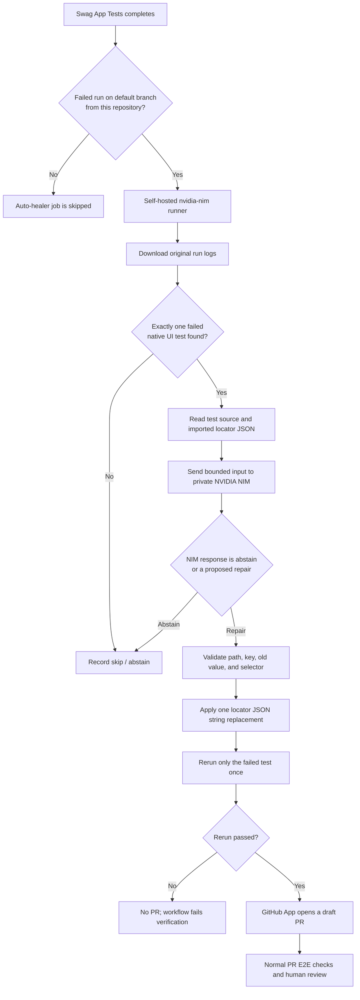

# CI Playwright UI Auto-Healer

This document explains the CI auto-healer: what it does, when it runs, how its
parts fit together, what data it sends to NVIDIA NIM, which changes it can make,
and what must be configured before it can operate.

## In one minute

The auto-healer is a **diagnose, verify, and propose** workflow. It is not an
automatic merge bot.

1. The **Swag App Tests** workflow fails on the default branch.
2. **Playwright UI Auto-Heal** downloads that run's logs and looks for exactly
   one failed native Playwright UI test under `src/tests/ui/`.
3. A private NVIDIA NIM endpoint receives the failed test source, the locator
   JSON files that the test imports with `readJson`, and at most the final
   24,000 characters of the failure logs after limited token-pattern redaction.
4. NIM can either abstain or suggest changing one existing selector string in
   one locator JSON file used by that test.
5. The helper validates the suggestion against the checked-out source, applies
   only that string change, and reruns the exact test once with retries disabled.
6. If the rerun passes, the workflow opens a **draft pull request** for a human
   to review. Normal pull-request checks run on that PR. Nothing merges
   automatically.

If the failure is ambiguous, is not a supported UI test, or cannot be repaired
within these narrow rules, the workflow does not make a change.

## Architecture



### Workflow boundaries

| Part | Responsibility |
| --- | --- |
| `.github/workflows/e2e.yml` | Runs the selected suite manually or all suites for pull requests targeting `main`. It uploads test reports and results. Only the default-branch report deployment job receives Pages write permission. |
| `.github/workflows/auto-heal-ui.yml` | Listens for completed **Swag App Tests** runs, applies the default-branch/same-repository/failure gates, and sequences diagnosis, verification, and draft PR creation. |
| `scripts/ci-auto-heal.js` | Downloads logs, finds one failure, contacts private NIM, validates the proposal, and applies the one-value edit. |
| `scripts/ci-auto-heal.test.js` | Tests key safety rules without contacting NIM or editing project locator files. |
| `src/tests/ui/` | The only supported test area. A failure must be reported in a format the helper recognizes. |
| `src/locators/*.json` | The only allowed repair target. The target file must be imported by the failed test through the recognized `readJson('locators/<file>.json')` pattern. |

## When it runs

The auto-healer subscribes to completed runs of the workflow named
**Swag App Tests**. Its job runs only when all of these conditions are true:

- The source workflow concluded with `failure`.
- The source branch is the repository's default branch.
- The source repository is the same repository as the workflow.

This excludes successful runs, feature-branch failures, and fork pull requests.
The listener workflow must be present on the default branch for GitHub Actions
to activate it.

The E2E workflow has two entry points:

- A manual **Run workflow** selection with UI, API, Accessibility, BDD, or All.
- A pull-request run for changes targeting `main`, which runs All.

Because the auto-healer listens to the named workflow rather than a particular
suite input, a failed manual API, accessibility, or BDD run on the default
branch can also start the auto-healer. It will then abstain if the logs do not
identify exactly one failed native UI test. To keep auto-healing limited to UI
failures, the E2E and auto-heal workflows would need a future change to pass
and gate on the selected suite or another explicit run marker.

## Detailed execution

### 1. Collect logs from the failed run

The job checks out the exact commit SHA that the E2E run tested. It uses the
workflow's read-only `GITHUB_TOKEN` permission (`actions: read`) to request the
run's log archive from the GitHub API. The helper follows GitHub's temporary
HTTPS download redirect without forwarding the GitHub token to the archive
host. The archive is unpacked in the runner's temporary directory and text
logs are combined for parsing.

### 2. Identify one failed test

The parser recognizes Playwright failure-summary lines for files matching
`src/tests/ui/*.spec.js`. It refuses to continue if:

- It cannot find a matching test line.
- The referenced spec file is not present in the checked-out commit.
- The log identifies more than one distinct failed test.

The test title is escaped and normalized for Playwright's `--grep` option, so
verification targets the reported test rather than the entire spec. As with any
title-based grep, another test with an overlapping title could also match; use
unique test titles. A failure in a different test layer is not repaired.

### 3. Gather a limited diagnosis payload

The helper reads the failed test source. It extracts locator JSON paths only
from literal imports matching the project's existing `readJson` convention,
and reads those files from `src/locators/`.

Before sending the log excerpt, it removes ANSI color codes, replaces strings
matching several common token prefixes (`nvapi-`, `ghp_`, `github_pat_`), and
keeps only the last 24,000 characters. This is limited redaction, not a
guarantee that logs contain no secrets; avoid printing secrets in test output.
The test source and locator contents are sent as supplied by the checked-out
commit.

The request uses the private endpoint's OpenAI-compatible
`/v1/chat/completions` API. It asks the model to return JSON in one of these
forms:

```json
{
  "decision": "abstain",
  "reason": "The failure does not show a stale locator."
}
```

or:

```json
{
  "decision": "repair",
  "reason": "The failure shows the login selector no longer matches.",
  "file": "src/locators/login.json",
  "key": "loginButton",
  "oldValue": "#login-button",
  "newValue": "[data-test=\"login-button\"]"
}
```

The model is instructed that logs and source are untrusted data, to avoid
changing application/test behavior or assertions, and to abstain when uncertain.
The model cannot edit files directly; its response is only a proposed change.

### 4. Validate and apply a repair

Before editing, the helper checks all of the following:

- The decision is explicitly `repair`.
- The file path matches `src/locators/<simple-name>.json`.
- That JSON file is actually imported by the failed test.
- The key is an existing, non-reserved top-level property.
- Its current value is a string and exactly equals `oldValue`.
- `newValue` is a different, non-empty selector of at most 300 characters and
  contains one of the supported stable identifier patterns, such as a
  `data-test` attribute, an ID, an `aria-label`, or a `name` attribute.
- The JSON text contains exactly one matching key/value entry to replace.

The edit preserves the rest of the JSON file's text and formatting. If any
check fails, the helper stops instead of attempting a broader edit.

### 5. Verify and create the PR

Playwright runs the failed test by spec and title, with `--retries=0`. A passing
rerun is required before the PR steps are allowed to run. If the rerun fails,
the job fails and no PR is opened.

For a passing repair, the workflow creates a short-lived GitHub App token and
opens a draft PR containing only changes under `src/locators/*.json`. The PR
description links to the original failed run and includes the diagnosis. The
GitHub App identity is used so the new PR triggers the regular `pull_request`
E2E workflow. A reviewer must inspect the selector and test intent; there is no
auto-merge step.

The verification artifact, if generated, is named
`auto-heal-verification-<run-id>` and is retained for 14 days.

## Helper script: functions from scratch

The workflow invokes `scripts/ci-auto-heal.js` four times as a command-line
program. Each invocation starts a new Node.js process; `main()` reads the
command name and arguments, then calls the matching function.

```text
download-logs <run-id> <archive-path>   Download the source run's log archive
locate <combined-log-path>              Identify one failed UI test
analyze <combined-log-path> <result>    Ask NIM and validate its proposal
apply <result>                          Revalidate and apply one locator edit
```

The workflow connects these commands in order. `locate` writes GitHub Actions
step outputs (`spec` and `grep`); those control whether the next steps run and
which test is rerun. `analyze` writes a JSON result file and step outputs
(`decision`, `spec`, `grep`, and `reason`). `apply` reads that result file and
checks it again before touching a locator. A new Node process is used at each
step, so outputs and the result JSON file are how the steps exchange state.

### What the script imports

The helper uses Node.js built-in modules only; it adds no separate npm
dependency:

- `node:fs` reads specs and logs, writes temporary result/output files, and
  applies the selector replacement.
- `node:path` creates paths rooted at the repository location.
- `node:dns/promises` and `node:net` resolve and classify endpoint addresses.
- `node:stream/promises` and `node:fs` streams the downloaded log archive to
  disk.
- `node:crypto` creates unique delimiters for GitHub Actions multiline outputs.

The model and GitHub APIs are called using Node's built-in `fetch`. Playwright,
the Actions runner, and `unzip` are workflow/runtime tools, not imports in this
helper.

### Shared settings and utilities

| Name | What it does |
| --- | --- |
| `repositoryRoot` | Resolves the project root from the helper's own location. Project spec and locator paths are joined to this root rather than the runner's current directory. |
| `allowedLocatorPath` | Restricts repair paths to a simple JSON filename under `src/locators/`; directory traversal and other file types do not match. |
| `maximumLogLength` | Caps the model's failure-log excerpt at 24,000 characters. |
| `privateDnsSuffixes` | Allows `.internal` and `.local` hostnames without a DNS address lookup. Configure those names only in trusted private DNS and enforce private routing with network policy. |
| `writeSummary(message)` | Appends a message to the GitHub Actions job summary when `GITHUB_STEP_SUMMARY` exists. Outside Actions it does nothing. |
| `writeOutput(name, value)` | Writes a named value to the current GitHub Actions step's output file when `GITHUB_OUTPUT` exists. It uses a generated delimiter so multiline values are safely represented. Outside Actions it does nothing. |
| `cleanLog(log)` | Removes ANSI color sequences, redacts three recognized token-prefix patterns, and keeps only the final 24,000 characters before the log is sent to NIM. It is not a complete secret scanner. |

### Detection and source-loading functions

#### `findUiSpec(log)`

Scans the combined Playwright output for failure-summary lines shaped like
`1) [chromium] › src/tests/ui/example.spec.js:10:3 › suite › test`. It:

1. Accepts only `.spec.js` paths under `src/tests/ui/`.
2. Rejects paths containing a `..` segment.
3. Confirms the spec exists in the checked-out failed commit.
4. Normalizes the nested Playwright title separators and escapes regular
   expression characters for `--grep`.
5. Returns `{ specPath, grep }` only if exactly one distinct failed test is
   found; otherwise returns `null`.

That return value is used by both `locate()` and `analyze()`. `grep` is a
title-based match, so UI test titles should be unique to avoid selecting another
test with an overlapping title.

#### `locatorFilesUsedBySpec(specPath)`

Reads the spec and searches for literal calls in this format:

```js
readJson('locators/login.json')
```

It resolves each match under `src/locators/`, includes only files that exist,
deduplicates/sorts paths, and returns objects shaped like
`{ path, content }`. It does not evaluate JavaScript or follow dynamically
constructed paths.

#### `locatorFilesForSpec(specPath)`

Wraps `locatorFilesUsedBySpec()`. It returns the discovered locator files, but
throws an explicit error if the spec has no recognized existing locator JSON
imports. This prevents the model from proposing a file outside the spec's
known locator inputs.

### Private endpoint and response functions

#### `isPrivateAddress(address)`

Checks whether an IP string is in the ranges the helper accepts:

- IPv4 RFC1918 private ranges and loopback.
- IPv6 loopback and unique-local (`fc...` or `fd...`) addresses.

It is used when checking literal IP URLs and DNS results. It is not a complete
network security boundary; runner routing and firewall rules are still needed.

#### `validatePrivateEndpoint(value)`

Validates `NVIDIA_NIM_BASE_URL` before sending the model request. It requires a
valid HTTPS URL ending in `/v1`, and rejects embedded username/password,
query-string, or fragment components. It accepts literal private IPs,
`.internal` and `.local` hostnames by suffix, or other hostnames only when every
resolved address passes `isPrivateAddress()`. It returns the parsed `URL` or
throws an actionable error. It does not make an HTTP request.

#### `parseModelJson(content)`

Converts the completion text into a JavaScript object. It accepts plain JSON,
JSON wrapped in a Markdown code fence, or a JSON object embedded in surrounding
text. If no valid JSON object can be extracted, it throws; malformed or
non-JSON model output is never treated as a successful abstention.

#### `validateRepair(result, allowedFiles)`

Checks an NIM repair proposal against strict rules before it can be used. It
validates the locator path, confirms that the file was imported by the failed
spec, checks for one allowed existing top-level key, validates old/new selector
types and stable-identifier patterns, parses the actual JSON, and compares the
current selector to the exact `oldValue`. Any mismatch throws an error.

This function is deliberately called twice: once on the model response in
`analyze()`, and again immediately before editing in `applyRepair()`. The second
check catches a changed or inconsistent result file before it can modify source.

### Workflow command functions

#### `downloadLogs(runId, archivePath)`

Implements the `download-logs` command. It checks that the run ID is numeric,
the repository name is valid, and `GH_TOKEN` is available. It requests the log
archive through the GitHub API with redirects disabled, requires GitHub's
expected HTTP 302 response, then fetches the redirect URL over HTTPS without
forwarding the GitHub token. It streams the archive to `archivePath` rather
than holding the whole response in memory. Network failures, unexpected HTTP
responses, and missing redirects fail the command.

#### `locate(logPath)`

Reads the combined log and calls `findUiSpec()`. If there is one supported
failed test, it writes the spec path and grep title to `GITHUB_OUTPUT`, which
the workflow exposes as `steps.locate.outputs.spec` and
`steps.locate.outputs.grep`. If not, it writes empty outputs, logs a skip
message, and appends that message to the workflow summary. The workflow uses the
empty spec output to skip dependency installation, NIM diagnosis, and repair.

#### `analyze(logPath, resultPath)`

Performs the model diagnosis:

1. Reads the original combined failure log and runs `findUiSpec()` again. This
   is a second guard beyond the workflow's earlier `locate` step.
2. If failure identification is ambiguous, writes an `abstain` result and
   summary, then returns without contacting NIM.
3. Reads the failed spec's imported locator files with
   `locatorFilesForSpec()`.
4. Requires `NVIDIA_API_KEY`, validates `NVIDIA_NIM_BASE_URL`, and chooses the
   configured model or the workflow's default model.
5. Builds a conservative JSON-only prompt. It marks logs, spec source, and
   locator contents as untrusted input and explicitly limits allowed repairs.
6. Sends the test source, locator contents, and `cleanLog()` output to the
   private endpoint with a 90-second timeout.
7. Checks the HTTP response and completion shape, parses JSON with
   `parseModelJson()`, validates the decision and reason, and calls
   `validateRepair()` for repair decisions.
8. Writes the complete result JSON to `resultPath`, exports decision/spec/grep/
   reason as step outputs, and records the diagnosis in the Actions summary.

An abstention is a normal no-change outcome. Configuration, networking,
unexpected HTTP responses, and invalid response-format errors stop the job
instead of silently continuing.

#### `applyRepair(resultPath)`

Implements the `apply` command. It reads the JSON result, requires a `repair`
decision, rediscovers the locator files for `specPath`, and calls
`validateRepair()` again. It then locates exactly one textual occurrence of
the key and old selector in the original JSON text, replaces only the selector
string, and writes the updated text back. If the entry is missing or repeated,
it refuses to edit. It does not rewrite/serialize the entire JSON object.

#### `main()`

Acts as the CLI dispatcher. It reads `process.argv`, validates that required
arguments were provided, and routes to `downloadLogs()`, `locate()`,
`analyze()`, or `applyRepair()`. Unsupported commands and missing arguments
produce explicit usage errors.

The `require.main === module` block runs `main()` only when this file is invoked
directly by Node. If a command throws, the error is printed and the process
exits with a non-zero status, so GitHub Actions marks that step as failed. The
module also exports `findUiSpec`, `parseModelJson`,
`validatePrivateEndpoint`, and `validateRepair` so unit tests can verify those
rules without running the workflow or contacting NIM.

## Network and data security

- The auto-heal job runs on a self-hosted runner labelled `nvidia-nim`; the
  runner must be isolated and have network access to the private NIM endpoint.
- The helper requires an HTTPS endpoint ending in `/v1`, with no URL username,
  password, query, or fragment.
- Literal addresses are accepted only for RFC1918 IPv4, loopback, or
  unique-local/loopback IPv6 ranges. Hostnames ending in `.internal` or `.local`
  are accepted by suffix without a DNS-address check; other hostnames must
  resolve only to private IP addresses from the runner.
- The `NVIDIA_API_KEY` is supplied to the diagnosis step as an environment
  secret. It is not placed in the prompt.
- The NIM request receives test source, imported locator JSON, and the bounded
  failure-log excerpt described above. Therefore, use only an endpoint approved
  for this repository's source and log data.
- The GitHub App private key is available only to the PR-creation step.
- The E2E PR test job has read-only repository permissions. Pages write and
  OIDC permissions are limited to the separate default-branch deployment job.
- Use an ephemeral runner where possible. A self-hosted runner executes
  repository-controlled code and should not retain credentials or workspaces
  between jobs.

The endpoint checks provide guardrails, but runner firewall/network policy is
the primary control for keeping NIM traffic private. In particular, the
`.internal` and `.local` suffixes are an explicit allowlist exception, not proof
that DNS resolves privately; ensure those names are controlled by your private
DNS and network policy.

## One-time setup

### 1. Prepare the self-hosted runner

Register an isolated Linux x64 runner for this repository with all of these
labels:

```text
self-hosted
linux
x64
nvidia-nim
```

The runner needs Node.js 20, npm access, `unzip`, and Playwright Chromium
dependencies. It must resolve and connect to the private NIM service. Prefer an
ephemeral runner that is destroyed or cleaned after each job instead of a
shared workstation.

### 2. Configure the `ci-auto-heal` environment

Create **Settings → Environments → `ci-auto-heal`** and add:

| Name | Type | Value |
| --- | --- | --- |
| `NVIDIA_NIM_BASE_URL` | Variable | Private OpenAI-compatible HTTPS URL ending in `/v1`, for example `https://nim.internal.example/v1`. |
| `NVIDIA_MODEL` | Variable | Model identifier served by the private NIM deployment. Optional; the workflow defaults to `nvidia/llama-3.3-nemotron-super-49b-v1.5`. |
| `NVIDIA_API_KEY` | Secret | Authentication key for the private endpoint. |
| `AUTO_HEAL_APP_ID` | Secret | App ID for the repository-scoped GitHub App. |
| `AUTO_HEAL_APP_PRIVATE_KEY` | Secret | Private key for that GitHub App. |

Do not put credentials in workflow YAML, source files, or normal variables.
Configure this environment without required reviewers if automatic diagnosis
should start without human approval.

### 3. Create and install a GitHub App

Install the app only on this repository and grant it:

- **Contents:** read and write
- **Pull requests:** read and write

The workflow requests only these permissions when minting its short-lived token.
The app identity is important: pull requests created with the default
`GITHUB_TOKEN` do not normally trigger another workflow. Avoid a personal access
token with broad account permissions.

### 4. Check repository Actions settings

Allow GitHub Actions to create pull requests if repository policy requires
enabling that setting. Keep the default branch protected with required reviews
and the normal E2E checks. Do not enable automatic merging for healer PRs.

If reports should publish to GitHub Pages, configure Pages to use **GitHub
Actions** as its build and deployment source. Pages deployment protection can
remain enabled; only the default-branch deployment job requests Pages
permissions.

## How to operate it

1. Ensure the latest E2E and auto-heal workflow files are on the default branch.
2. Open **GitHub → Actions → Swag App Tests → Run workflow**.
3. Select a suite and run it on the default branch. The workflow currently
   defaults to All for a pull-request run; an auto-heal attempt is considered
   only when that E2E run fails.
4. Open the failed run and its summary/logs. The downstream
   **Playwright UI Auto-Heal** run should appear in Actions if the run passed
   the listener gates.
5. If a draft PR is created, review the locator diff and its regular CI checks.
   Merge it only through the repository's normal review and branch-protection
   process.

No PR is expected when the issue is not one unambiguous stale locator, when NIM
abstains, or when the verification rerun fails.

## Troubleshooting

| Symptom | Likely explanation / check |
| --- | --- |
| Auto-heal workflow does not start | Confirm the source workflow is named `Swag App Tests`, failed on the default branch, and came from this repository. Confirm both workflow files exist on the default branch. |
| Job waits for a runner | Check that an online runner has all four required labels, especially `nvidia-nim`. |
| Logs cannot be downloaded | Confirm the token has `actions: read`; check run ID, GitHub API access, and runner outbound access to GitHub. |
| “Could not identify exactly one…” | The log format may not match the parser, the failure may be outside `src/tests/ui/`, the spec may not exist at the failed commit, or multiple tests failed. The workflow intentionally abstains. |
| Locator import error | The spec needs a literal `readJson('locators/<name>.json')` reference to an existing locator JSON file for the helper to include it. |
| Endpoint validation error | Verify HTTPS, `/v1`, no credentials/query/fragment, private DNS resolution (except the configured `.internal`/`.local` suffix allowlist), and runner routing/firewall rules. |
| NIM authentication or HTTP error | Check the `ci-auto-heal` environment secret, model identifier, endpoint health, and endpoint's OpenAI-compatible API configuration. |
| Proposal rejected | Check the diagnosis result and current locator file. Stale old values, unrelated files/keys, unstable selectors, or ambiguous JSON entries are deliberately rejected. |
| Rerun fails | No PR is created. Inspect the verification artifact and test output; the problem may not be a selector issue. |
| Draft PR is created but checks do not run | Confirm the GitHub App is installed on this repository with the required permissions and that the PR targets `main`. |

## Local safety tests

Run the focused helper tests without contacting NIM:

```bash
node --test scripts/ci-auto-heal.test.js
```

These cover failure selection, ambiguous failures, current-value validation,
scope/stable-selector checks, private endpoint validation, and JSON response
parsing. The existing UI suite can be run separately with:

```bash
npm run test:ui
```

## Current scope and limitations

- This is a conservative selector repair flow, not a general-purpose agent that
  fixes arbitrary test, application, API, accessibility, or infrastructure
  failures.
- It handles one distinct failed UI test at a time. Multiple failures cause it
  to abstain rather than guess which one to repair.
- It only understands native Playwright `.spec.js` failure-summary lines under
  `src/tests/ui/`.
- It discovers locator inputs by matching literal `readJson('locators/...')`
  calls in the failed spec. Dynamically constructed imports are not discovered.
- It does not inspect the live page DOM or independently establish that a
  proposed selector uniquely matches the intended control; the test rerun and
  human PR review are still required.
- The rerun verifies the selected failed test only. The PR's normal E2E checks
  provide broader validation.
- Redaction is pattern-based and limited. Test logs should never print secrets.
- A manually selected non-UI suite on the default branch can activate the
  listener but will normally be skipped by UI-test detection.
